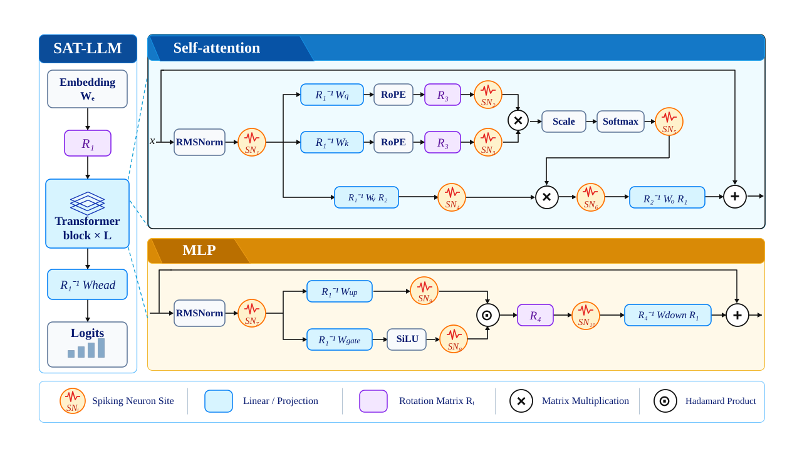
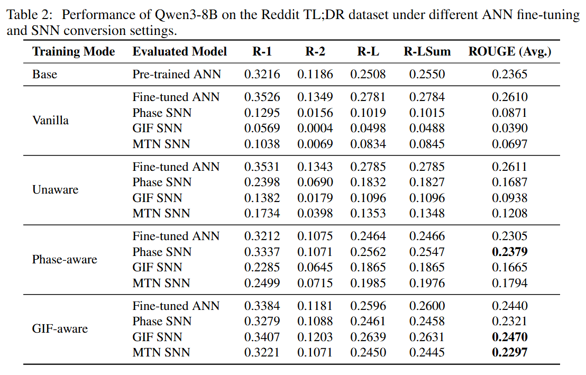
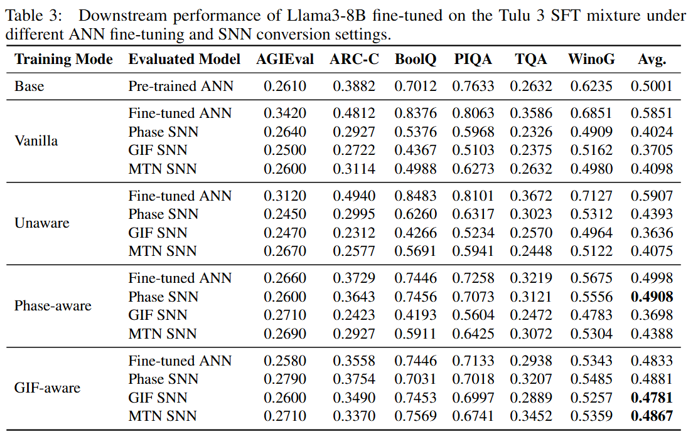

# SNN

本项目用于研究 **Transformer 大语言模型从 ANN fine-tuning 到 SNN deployment 的转换流程**。当前实现围绕 **SAT-LLM** 展开：在 ANN fine-tuning 阶段显式引入后续脉冲部署相关的神经元行为，使优化后的 ANN 更适合低 timestep 的 SNN conversion 与 temporal deployment。

## SAT-LLM 概览

  

SAT-LLM 首先对 Transformer 进行 Hadamard rotation，以缓解 activation outlier；随后在 Self-attention 与 MLP 中设置 10 个 layer-local spiking neuron replacement sites。`phase_aware` 与 `gif_aware` 在 ANN fine-tuning 阶段分别局部实现 Phase 或 GIF 神经元行为，并结合 neuron-independent common clipping；时间维度不会在 ANN layer 之间传播。Fine-tuning 完成后，模型可进一步转换为采用 Phase、GIF 或 MTN 神经元的 full-temporal SNN。

## 主要入口

- [`环境配置.md`](环境配置.md)：运行环境与依赖配置。
- [`实验执行总结.md`](实验执行总结.md)：当前实验执行顺序、artifact 依赖与常用命令。
- [`代码结构总结.md`](代码结构总结.md)：仓库目录结构及主要模块说明。
- [`AGENTS.md`](AGENTS.md)：后续修改代码时需要遵守的项目规则。

## 当前实现

项目当前主要支持：

- Qwen3 Base 系列上的 Reddit TL;DR summarization 实验。
- Llama 3 Base 上的 Tulu 3 / lm-eval 实验。
- 四种 ANN 设置：`vanilla`、`unaware`、`phase_aware`、`gif_aware`。
- 每个 Transformer layer 固定 10 个 activation replacement sites。
- Hadamard Rotation，包括离线权重融合与在线 R3/R4 变换。
- Prefix 技术：Prefix 预先转换为固定 KV cache，并在 training、calibration 或 evaluation 的指定阶段注入。
- 双套 SNN artifact source：non-vanilla 可选择 shared Pre-finetuning Prefix + ANN-training Stage A，或 per-run Post-finetuning Prefix + Stage A。
- Phase、GIF、MTN 三类 SNN conversion 与 temporal deployment。
- TL;DR ROUGE evaluation 与 lm-eval evaluation。

## 实验结果

### Qwen3-8B：Reddit TL;DR

  

### Llama3-8B：Tulu 3 SFT mixture

  

从结果可以看到，常规 ANN fine-tuning 在转换为低 timestep SNN 后存在明显性能下降；`phase_aware` 与 `gif_aware` 通过在 ANN 优化阶段显式考虑脉冲神经元行为，能够显著缩小 ANN→SNN 的 conversion gap。两种 aware 模式都具备一定的 cross-neuron generalization，其中 `gif_aware` 在不同部署神经元之间表现出更稳定的泛化。

## ANN Fine-tuning

`vanilla` 和 `unaware` 不执行 activation replacement。其中 `vanilla` 使用原始 ANN 进行常规 fine-tuning，`unaware` 在 Hadamard-rotated ANN 上进行 fine-tuning，但仍不显式建模后续 spiking deployment。

`phase_aware` 与 `gif_aware` 在 ANN fine-tuning 阶段分别使用 Phase 或 GIF replacement。ANN-training calibration 拆成 T/K-independent Stage A 和按 `phase.T/mtn.T` 隔离的 Stage B Clip profile；`replacement.common_clip_enabled` 只决定是否应用已选 profile。Site 5 永久 no-Clip，SNN conversion/deployment 始终不执行 common Clip。

## ANN Training / Final ANN Evaluation / SNN Evaluation Semantics

`--neuron ann` 表示 non-temporal final ANN execution，并不等价于 identity。Final ANN evaluation 会按 checkpoint 的 `ann_mode` 自动恢复训练期 static activation semantics。

| Mode          | ANN training                                                 | Final ANN `--neuron ann`                               | SNN `--neuron phase/gif/mtn` |
| ------------- | ------------------------------------------------------------ | ------------------------------------------------------ | ---------------------------- |
| `vanilla`     | identity                                                     | identity                                               | temporal selected neuron     |
| `unaware`     | identity                                                     | identity                                               | temporal selected neuron     |
| `phase_aware` | `PhaseSurrogate.forward()`                                   | 同一 ANN-training states 的 `PhaseSurrogate.forward()` | temporal selected neuron     |
| `gif_aware`   | Site 1/7 使用 role-aware `StaticGIF`，Site 2 使用 all-low 4-bit GIF，Site 5/8/9 为 identity，其余 salient sites 使用 `StaticGIF` | 同一 ANN-training states 的 static GIF forward         | temporal selected neuron     |

Aware final ANN evaluation 同时镜像训练期 common Clip 开关；SNN evaluation 永远不执行 common Clip。`phase_aware`/`gif_aware` 的 site-local surrogate 会立即聚合回 static tensor，时间维度不跨层传播，因此仍属于 ANN fine-tuning；只有 `deploy_phase/gif/mtn` 属于 full-temporal SNN。Base 与 rotated-pre-finetuning diagnostic 始终保持 identity semantics。

## SNN Conversion Artifact Source

`conversion.use_post_finetuning_artifacts` 是 SNN conversion 与 SNN evaluation 的唯一 artifact source selector：`true` 选择每个 Final ANN run 的 Post-finetuning Prefix + Post-finetuning Stage A；`false` 选择 shared Pre-finetuning Prefix + shared ANN-training Stage A。`vanilla` 只能选择 `true`。

| ANN mode      | selector=false                                  | selector=true                                    |
| ------------- | ----------------------------------------------- | ------------------------------------------------ |
| `vanilla`     | 非法                                            | Post-finetuning Prefix + Post-finetuning Stage A |
| `unaware`     | shared Pre Prefix + shared ANN-training Stage A | Post Prefix + Post Stage A                       |
| `phase_aware` | shared Pre Prefix + shared ANN-training Stage A | Post Prefix + Post Stage A                       |
| `gif_aware`   | shared Pre Prefix + shared ANN-training Stage A | Post Prefix + Post Stage A                       |

`unaware`、`phase_aware` 与 `gif_aware` 可以同时拥有两套 artifact。selector 不改变 ANN checkpoint，也不改变 Final ANN evaluation。aware 的 Post-finetuning artifacts 从各自 Final ANN 生成，并保存在各自 run 的 `post_finetuning/` 下，不进入 `_shared`。

SNN conversion/deployment 只读取 Stage A，永不读取 ANN-training Stage B Clip；Post-finetuning calibration 仅有完全 clip-free 的 Stage A。

Final ANN Prefix 规则独立保持：vanilla 不加载 Prefix；unaware 按 `evaluation.prefix_enabled` 从 Post-finetuning Prefix 加载；phase-aware/gif-aware 按同一开关从 Pre-finetuning Prefix 加载。